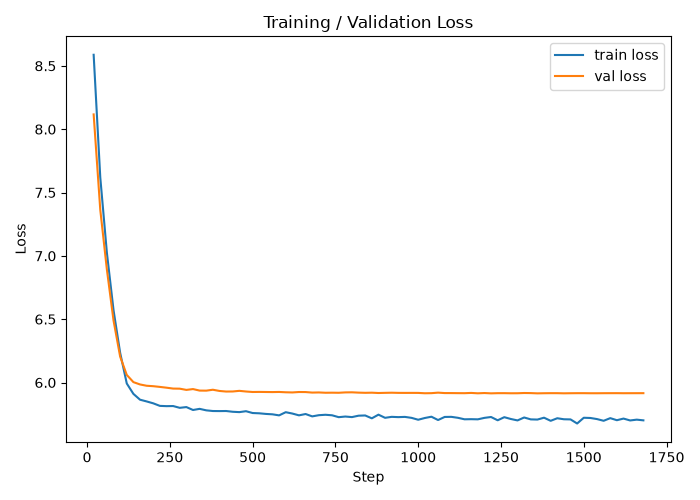

# JAX MiniGPT Pretraining Workflow

This project is a clean, modular JAX/Flax implementation for pretraining a miniature GPT model on the TinyStories dataset. 

## Features
- Custom BPE Tokenizer training matching the dataset size.
- Full Transformer with `MultiHeadAttention`, Pre-LayerNorm, and FeedForward layers.
- Cross-entropy loss with padding token masking.
- Gradient clipping and proper temperature sampling for inference.
- Validation loop and loss curve plotting.

## Project Structure
- `src/config.py`: Hyperparameters and paths.
- `src/data.py`: Dataset loading, Tokenizer training, and PyGrain dataloader.
- `src/model.py`: Flax NNX model definitions.
- `src/train.py`: Main training loop.
- `src/infer.py`: Checkpoint loading and Gradio interface.
- `src/test_queries.py`: Tests the model with 10 sample prompts.

## Setup

1. **Create and activate a virtual environment (optional but recommended):**
   ```bash
   python -m venv venv
   # Windows:
   venv\Scripts\activate
   # Linux/Mac:
   source venv/bin/activate
   ```

2. **Install dependencies:**
   ```bash
   pip install -r requirements.txt
   ```

3. **Provide Dataset:**
   Ensure `TinyStories-1000.txt` is in the root directory of this project. 
   *(You can find the full TinyStories dataset on HuggingFace at [roneneldan/TinyStories](https://huggingface.co/datasets/roneneldan/TinyStories))*

## Usage

**1. Train the model:**
```bash
python -m src.train
```
This will train the custom BPE tokenizer, train the model, plot a loss curve `training_loss.png`, and save an Orbax checkpoint `small_checkpoint.orbax`.



**2. Test with sample queries:**
```bash
python -m src.test_queries
```
This will load the saved model and run 10 sample prompts to demonstrate text generation.

**3. Launch the Web UI:**
```bash
python -m src.infer
```
This launches a Gradio web interface to interactively generate stories.

## Training Details & Results

This project pretrains a lightweight Transformer (decoder-only) from scratch:
- **Parameters**: ~3.5 Million (192 Embed Dim, 768 FF Dim, 6 Heads, 6 Layers)
- **Vocabulary**: 4096 tokens (Custom ByteLevel BPE trained on this dataset)
- **Optimizer**: AdamW with Weight Decay (0.01) and Gradient Clipping (1.0)

During training, both training loss and validation loss decay smoothly alongside the learning rate schedule over 60 epochs (1,680 steps). 

<details>
<summary>Click to view the training log progression</summary>

```text
Loaded 1,000 stories from /content/TinyStories-1000.txt
Train stories: 900  |  Val stories: 100
Training a new BPE tokenizer (vocab_size=4096) on this dataset...
Saved tokenizer to story_tokenizer/tokenizer.json
Tokenizer vocab size: 4096, pad_id=0, eos_id=1
Total training steps: 1,680  |  Warmup steps: 168
Step 20/1680  train_loss=8.5877  val_loss=8.1168  lr=3.57e-05
Step 40/1680  train_loss=7.6189  val_loss=7.3636  lr=7.14e-05
Step 60/1680  train_loss=7.0234  val_loss=6.8914  lr=1.07e-04
Step 80/1680  train_loss=6.5720  val_loss=6.4903  lr=1.43e-04
Step 100/1680  train_loss=6.2346  val_loss=6.2050  lr=1.79e-04
Step 120/1680  train_loss=5.9926  val_loss=6.0602  lr=2.14e-04
Step 140/1680  train_loss=5.9106  val_loss=6.0034  lr=2.50e-04
Step 160/1680  train_loss=5.8646  val_loss=5.9849  lr=2.86e-04
Step 180/1680  train_loss=5.8508  val_loss=5.9746  lr=3.00e-04
Step 200/1680  train_loss=5.8359  val_loss=5.9711  lr=3.00e-04
Step 220/1680  train_loss=5.8158  val_loss=5.9655  lr=2.99e-04
Step 240/1680  train_loss=5.8137  val_loss=5.9594  lr=2.98e-04
Step 260/1680  train_loss=5.8144  val_loss=5.9524  lr=2.97e-04
Step 280/1680  train_loss=5.8004  val_loss=5.9516  lr=2.96e-04
Step 300/1680  train_loss=5.8063  val_loss=5.9419  lr=2.95e-04
Step 320/1680  train_loss=5.7833  val_loss=5.9484  lr=2.93e-04
Step 340/1680  train_loss=5.7923  val_loss=5.9365  lr=2.91e-04
Step 360/1680  train_loss=5.7805  val_loss=5.9360  lr=2.89e-04
Step 380/1680  train_loss=5.7752  val_loss=5.9432  lr=2.86e-04
Step 400/1680  train_loss=5.7746  val_loss=5.9336  lr=2.83e-04
Step 420/1680  train_loss=5.7752  val_loss=5.9290  lr=2.81e-04
Step 440/1680  train_loss=5.7692  val_loss=5.9295  lr=2.77e-04
Step 460/1680  train_loss=5.7665  val_loss=5.9345  lr=2.74e-04
Step 480/1680  train_loss=5.7737  val_loss=5.9293  lr=2.71e-04
Step 500/1680  train_loss=5.7593  val_loss=5.9255  lr=2.67e-04
Step 520/1680  train_loss=5.7572  val_loss=5.9260  lr=2.63e-04
Step 540/1680  train_loss=5.7523  val_loss=5.9254  lr=2.59e-04
Step 560/1680  train_loss=5.7491  val_loss=5.9247  lr=2.55e-04
Step 580/1680  train_loss=5.7409  val_loss=5.9257  lr=2.50e-04
Step 600/1680  train_loss=5.7659  val_loss=5.9231  lr=2.45e-04
Step 620/1680  train_loss=5.7552  val_loss=5.9218  lr=2.41e-04
Step 640/1680  train_loss=5.7410  val_loss=5.9252  lr=2.36e-04
Step 660/1680  train_loss=5.7515  val_loss=5.9248  lr=2.31e-04
Step 680/1680  train_loss=5.7329  val_loss=5.9207  lr=2.25e-04
Step 700/1680  train_loss=5.7422  val_loss=5.9218  lr=2.20e-04
Step 720/1680  train_loss=5.7456  val_loss=5.9194  lr=2.15e-04
Step 740/1680  train_loss=5.7414  val_loss=5.9199  lr=2.09e-04
Step 760/1680  train_loss=5.7266  val_loss=5.9192  lr=2.03e-04
Step 780/1680  train_loss=5.7316  val_loss=5.9221  lr=1.98e-04
Step 800/1680  train_loss=5.7272  val_loss=5.9228  lr=1.92e-04
Step 820/1680  train_loss=5.7383  val_loss=5.9203  lr=1.86e-04
Step 840/1680  train_loss=5.7401  val_loss=5.9189  lr=1.80e-04
Step 860/1680  train_loss=5.7175  val_loss=5.9199  lr=1.74e-04
Step 880/1680  train_loss=5.7464  val_loss=5.9174  lr=1.68e-04
Step 900/1680  train_loss=5.7215  val_loss=5.9187  lr=1.62e-04
Step 920/1680  train_loss=5.7292  val_loss=5.9197  lr=1.56e-04
Step 940/1680  train_loss=5.7270  val_loss=5.9184  lr=1.50e-04
Step 960/1680  train_loss=5.7287  val_loss=5.9182  lr=1.44e-04
Step 980/1680  train_loss=5.7211  val_loss=5.9183  lr=1.38e-04
Step 1000/1680  train_loss=5.7063  val_loss=5.9182  lr=1.32e-04
Step 1020/1680  train_loss=5.7201  val_loss=5.9154  lr=1.26e-04
Step 1040/1680  train_loss=5.7302  val_loss=5.9162  lr=1.20e-04
Step 1060/1680  train_loss=5.7040  val_loss=5.9202  lr=1.15e-04
Step 1080/1680  train_loss=5.7284  val_loss=5.9169  lr=1.09e-04
Step 1100/1680  train_loss=5.7292  val_loss=5.9168  lr=1.03e-04
Step 1120/1680  train_loss=5.7216  val_loss=5.9163  lr=9.76e-05
Step 1140/1680  train_loss=5.7098  val_loss=5.9160  lr=9.21e-05
Step 1160/1680  train_loss=5.7108  val_loss=5.9180  lr=8.67e-05
Step 1180/1680  train_loss=5.7095  val_loss=5.9150  lr=8.15e-05
Step 1200/1680  train_loss=5.7211  val_loss=5.9172  lr=7.63e-05
Step 1220/1680  train_loss=5.7280  val_loss=5.9147  lr=7.13e-05
Step 1240/1680  train_loss=5.7020  val_loss=5.9161  lr=6.65e-05
Step 1260/1680  train_loss=5.7265  val_loss=5.9162  lr=6.18e-05
Step 1280/1680  train_loss=5.7121  val_loss=5.9153  lr=5.73e-05
Step 1300/1680  train_loss=5.7010  val_loss=5.9155  lr=5.29e-05
Step 1320/1680  train_loss=5.7241  val_loss=5.9174  lr=4.87e-05
Step 1340/1680  train_loss=5.7092  val_loss=5.9167  lr=4.47e-05
Step 1360/1680  train_loss=5.7077  val_loss=5.9147  lr=4.09e-05
Step 1380/1680  train_loss=5.7225  val_loss=5.9156  lr=3.73e-05
Step 1400/1680  train_loss=5.6979  val_loss=5.9162  lr=3.39e-05
Step 1420/1680  train_loss=5.7181  val_loss=5.9161  lr=3.06e-05
Step 1440/1680  train_loss=5.7101  val_loss=5.9150  lr=2.77e-05
Step 1460/1680  train_loss=5.7090  val_loss=5.9157  lr=2.49e-05
Step 1480/1680  train_loss=5.6766  val_loss=5.9161  lr=2.23e-05
Step 1500/1680  train_loss=5.7220  val_loss=5.9161  lr=2.00e-05
Step 1520/1680  train_loss=5.7202  val_loss=5.9155  lr=1.79e-05
Step 1540/1680  train_loss=5.7116  val_loss=5.9155  lr=1.61e-05
Step 1560/1680  train_loss=5.6981  val_loss=5.9159  lr=1.45e-05
Step 1580/1680  train_loss=5.7189  val_loss=5.9161  lr=1.31e-05
Step 1600/1680  train_loss=5.7026  val_loss=5.9162  lr=1.20e-05
Step 1620/1680  train_loss=5.7155  val_loss=5.9157  lr=1.11e-05
Step 1640/1680  train_loss=5.7007  val_loss=5.9159  lr=1.05e-05
Step 1660/1680  train_loss=5.7071  val_loss=5.9160  lr=1.01e-05
Step 1680/1680  train_loss=5.7015  val_loss=5.9162  lr=1.00e-05
Saved loss curve to training_loss.png
Model saved to /content/small_checkpoint.orbax
```
</details>

## Troubleshooting

### Windows: `[WinError 3]` during pip install
If you encounter a `[WinError 3] The system cannot find the path specified` error when installing `requirements.txt` on Windows (specifically failing on `orbax-checkpoint`), it is due to Windows' 260-character maximum path limit. 

To fix this, you must enable **Long Paths** in Windows. You can do this either by:
- Enabling the "Enable Win32 long paths" option in the Local Group Policy Editor (`gpedit.msc`).
- Or by setting the `LongPathsEnabled` registry key to `1` in `HKEY_LOCAL_MACHINE\SYSTEM\CurrentControlSet\Control\FileSystem` using the Registry Editor (`regedit`).

Once enabled, simply retry `pip install -r requirements.txt`.
